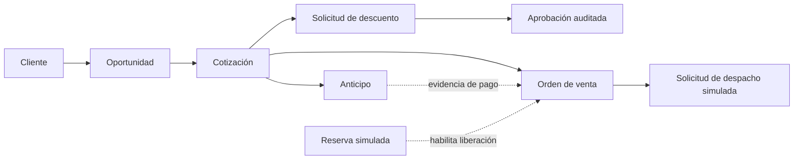

# Comercial — alcance semanal desde la fuente

[Índice](../../README.md) · [Análisis del PDF](../fuentes/analisis-comercial.md)

**Sprint:** 5–11 de noviembre de 2026. **Capacidad:** 3 h diarias por persona, siete días: 63 h.
Plan de 42 h, incluida preparación y cierre; 21 h de reserva para aprender, revisar y corregir.
Estado al 2026-11-07: COM-001 y COM-002 integradas en `main` (PR #104); COM-003 y COM-004 en Ready; COM-005 en In Progress y lista para PR tras cumplir sus criterios. Cotización y el resto del recorrido siguen pendientes; no hay avances heredados.

## Objetivo verificable
Un asesor registra una oportunidad retail MTS, genera una cotización con precio de lista, solicita un descuento auditado, registra la aceptación y el anticipo, y obtiene una OV solo con pago confirmado y reserva comprometida.
Desde la OV se reconstruyen documentos, responsables, estados y aprobaciones, sin volver a digitar los datos de la cotización.

## Núcleo
- Cliente y oportunidad con productos, canal, sede y responsable (p. 15).
- Lista de precios vigente y líneas protegidas contra edición manual (p. 22).
- Cotización desde oportunidad: identificador, vigencia, cálculo configurable y plazo; envío simulado y resultado (pp. 25–27).
- Descuento con motivo, límite y aprobación o rechazo auditados (pp. 4, 23).
- Anticipo con comprobante y confirmación simulada por Tesorería (p. 29).
- Conversión única a OV: bloqueo sin pago, copia de datos y reserva comprometida (pp. 34–35).
- Ficha imprimible de cada documento y navegación de la cadena; persistencia e historial comprobables.
- Roles necesarios para el guion: Asesor, Jefatura y Tesorería. Sin autenticación real; las reglas por rol se validan también en la API.

## Relaciones a demostrar
Cliente tiene oportunidades; una oportunidad tiene cotizaciones.
La cotización tiene líneas y solicitudes de descuento; cada aprobación pertenece a su solicitud.
Anticipo y OV referencian la cotización. La OV conserva además la evidencia de pago y reserva.
El anticipo NO es el único padre de la OV: la cadena es un conjunto de relaciones, no una lista artificial.
Cada documento tiene historial propio, con usuario/rol, fecha y hora, acción, estados y motivo.

## Simulaciones y fronteras
- Logística: consultar disponibilidad, crear reserva, comprometerla y recibir solicitud de despacho. Respuestas con identificador, fecha y estado; al menos un caso rechazado. No hay almacén ni despacho real.
- Finanzas: confirmar o rechazar un anticipo mediante acción del rol Tesorería; banco simulado. No se implementan conciliación ni contabilidad.
- Correo: registrar el envío simulado; no enviar mensajes reales.
- Datos ficticios. Valores de demo acordados en COM-001 y guardados en configuración.
La reserva y el pago simulados se identifican en pantalla e historial. El proveedor real sustituirá el adaptador por contrato en su propio sprint.

## Fuera de esta semana
MTO, crédito B2B, Postventa, garantías, producción, inventario real, despacho/POD, facturación/SUNAT, PDF oficial, recordatorios automáticos, indicadores y bandejas avanzadas.
Pertenecer a Comercial no convierte automáticamente una función en compromiso de esta semana. No se programa otro sprint de Comercial ni se presenta el área completa del PDF como terminada.

## Controles y recorte
- 7/11: preparación y modelo trazable, cliente y oportunidad persistentes; dependencias simuladas.
- 9/11: cotización, descuento y validación de pago integrables; revisar capacidad de cierre.
- 11/11: guion completo en API y pantalla, con rechazos y persistencia después de reiniciar.
Ante retrasos, simplificar navegación y presentación. No recortar relaciones, auditoría, bloqueo sin pago ni evidencia de validación.
Si el núcleo no termina, resultado Parcial: mantener el sprint de una semana y reconocer lo que falta.
