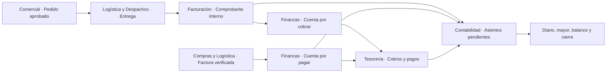

# Arquitectura del ERP FAMIHOGAR

[Inicio](../README.md) · [Prueba integrada](prueba-integrada.md) · [Decisiones](decisiones.md)

## Ejecución y estructura

El servidor HTTP estático entrega los archivos de `src/Erp.Api/wwwroot`. El navegador ejecuta las pantallas y las reglas de negocio en HTML, CSS y JavaScript. El nombre de la carpeta `Erp.Api` se conserva del repositorio y la ejecución actual sirve archivos estáticos.

| Responsabilidad | Archivos principales |
|---|---|
| Entrada, sesión, sede, rutas, menús y formularios compartidos | [index.html](../src/Erp.Api/wwwroot/index.html) y [aplicaciones.js](../src/Erp.Api/wwwroot/aplicaciones.js) |
| Diseño, zonas de trabajo, móvil e impresión | [estilos.css](../src/Erp.Api/wwwroot/estilos.css) y los bloques imprimibles de las fichas |
| Ayuda contextual y secuencias sugeridas | `ayuda.js`, `ayuda-guias.js`, `recorridos.js` y `recorridos-logistica.js` |
| Comercial | `datos-comercial.js`, `reglas-comerciales.js`, `pantallas-comerciales.js` y `ContratosComerciales` en `aplicaciones.js` |
| Logística, Compras y Despachos | `datos-logistica.js`, `logistica-aplicacion.js`, `logistica-reglas.js`, `compras-reglas.js`, `almacenes-reglas.js`, `distribucion-reglas.js` y sus pantallas |
| Facturación, Finanzas y Contabilidad | `pantallas-libros.js` organiza las vistas de las tres áreas. Cada área tiene su archivo `pantallas-*.js` |
| Reportes | `pantallas-reportes.js` presenta y exporta consultas. `reportes.js` calcula indicadores y tablas a partir de los registros operativos |
| Reglas de documentos, movimientos y asientos | `finanzas-reglas.js`, `contabilidad-reglas.js` y `libros.js`. `Finanzas.registrarVenta` valida el perfil de Facturación y guarda el documento, su cuenta y su asiento |
| Permisos e integración | `permisos.js`, `integraciones-locales.js` y los contratos públicos |
| Pruebas y evaluación del inventario | [tests/interfaz](../tests/interfaz), `logistica-evaluacion.js` y [generar-evaluacion-kardex.cjs](../scripts/generar-evaluacion-kardex.cjs) |

Las rutas usan el fragmento de la URL. `#facturacion/comprobantes` abre un listado y `#finanzas/cobrar/<id>` abre una ficha. Los archivos de la entrada llevan una versión en su URL para que el navegador cargue dependencias compatibles al cambiar la aplicación.

Las pantallas agrupan acciones y registros en zonas que se distinguen con divisores. La interfaz usa un tema oscuro con niveles de grafito, acentos cian y colores semánticos. Los comprobantes y reportes se imprimen con una paleta clara. La navegación queda en el lateral en escritorio y pasa a una franja horizontal en pantallas estrechas. Los botones **?** ofrecen ayuda y **Paso sugerido** orienta el recorrido. Los selectores pueden preseleccionar el documento de origen y sugerir valores. Las reglas validan al ejecutar la operación. Guardar actualiza la vista actual y ofrece **Ver registro guardado** si la ficha está en otra ruta.

## Datos y persistencia

| Área | Medio y clave | Contenido |
|---|---|---|
| Comercial | `localStorage` · `famihogar.comercial.v1` · esquema 2 | Clientes, productos, oportunidades, listas, promociones, cotizaciones, pedidos y solicitudes |
| Logística | `localStorage` · `famihogar.logistica.v1` · esquema 2 | Proveedores, compras, almacenes, ubicaciones, recepciones, calidad, inventario, reservas, despachos, traslados, devoluciones y conteos |
| Facturación, Finanzas y Contabilidad | `localStorage` · `famihogar.libros.v1` · esquema 1 | Documentos de venta y compra, crédito, pagos, movimientos, turnos, extractos, asientos, activos y cierres |
| Sesión | `sessionStorage` · `famihogar.sesion` | Nombre, perfil y sede activa |

La sesión se mantiene al recargar. **Salir** elimina la sesión y conserva los documentos. Los registros pertenecen al origen y perfil del navegador. Usar otro puerto, otro perfil o un equipo distinto puede mostrar otro conjunto de datos. Eliminar los datos del sitio borra sus registros locales.

Al abrir el ERP por primera vez en un perfil sin datos guardados, `registros-demo.js` aporta un escenario ficticio común e `inicializar-demo.js` lo copia a las tres claves antes de iniciar la aplicación. La carga automática conserva los perfiles con registros previos. Desde la pantalla de acceso se puede abrir una carga manual que solicita descargar un respaldo antes de sustituir los datos del perfil. Cada perfil guarda localmente los cambios posteriores.

Los importes se representan como céntimos de sol. Las fichas usan identificadores UUID, correlativos legibles, sede, referencias de origen e historial de acciones cuando corresponde. Clientes y catálogo son compartidos. Las operaciones aplican su filtro de sede y hay excepciones de proceso, como la consulta de traslados desde origen y destino.

Cada comando relee su estado, aplica las reglas y guarda una vez. En Libros, el documento o movimiento y su asiento propuesto quedan en la misma escritura. Las áreas se consultan entre sí a través de funciones públicas. La aplicación atiende eventos de almacenamiento del mismo origen y su persistencia local carece de garantía transaccional entre claves o pestañas.

## Integración

| Consulta | Datos |
|---|---|
| Comercial a Logística | Disponibilidad, salidas, entregas y recepción de devoluciones |
| Comercial a Finanzas | Límite, exposición y vencidos del cliente |
| Facturación a Comercial y Logística | Pedido, cliente, condiciones, entregas confirmadas y costo de lo entregado según el Kardex |
| Finanzas a Logística | Facturas verificadas y proveedores aprobados |
| Logística a Finanzas | Estado de pago de una factura verificada |
| Contabilidad a Logística | Fecha y valor del inventario inicial de la sede |
| Comercial a Facturación | **Consultar seguimiento** incorpora la referencia del comprobante emitido al pedido |

[Contratos de Comercial](contratos/integracion-comercial.md) · [Contratos de Logística](contratos/integracion-logistica.md)

## Perfiles

| Perfil | Responsabilidad principal |
|---|---|
| Asesor | Clientes, oportunidades, cotizaciones, pedidos, postventa y solicitudes propias de abastecimiento |
| Compras | Proveedores, peticiones, ofertas, órdenes de compra, cotejo y planificación según el acceso |
| Almacén | Recepción, inspección, reserva, picking, embalaje, salida, retornos y movimientos autorizados |
| Transporte | Inicio de ruta y confirmación de entrega total, parcial o fallida |
| Facturación | Emisión y consulta de comprobantes internos de venta |
| Tesorería | Cobros, programación y confirmación de pagos aprobados, caja, extractos y conciliación |
| Contabilidad | Contabilización, apertura de inventario, activos, depreciación y cierre |
| Jefatura | Revisión y aprobación de operaciones, decisiones sobre crédito y fondos iniciales, y operaciones admitidas en cada área |
| Super Admin | Acceso a los comandos implementados y excepción de revisión independiente para la demostración en una sola sesión |

Las operaciones con revisión independiente comprueban que el autor y el revisor sean personas distintas, aunque cambie el perfil seleccionado. El historial registra nombre y rol. La selección del perfil y sus validaciones operan en el cliente. Una instalación multiusuario requeriría autenticación, autorización y persistencia en servidor.

## Alcance pendiente

- El retorno físico de una devolución se puede registrar. La emisión de nota de crédito y su regularización financiera siguen pendientes.
- La facturación es interna y de demostración. La conciliación usa partidas ingresadas manualmente. Las conexiones tributarias y bancarias corresponden a otra etapa.
- Los diagramas TO-BE se prepararán a partir de la revisión del prototipo.
